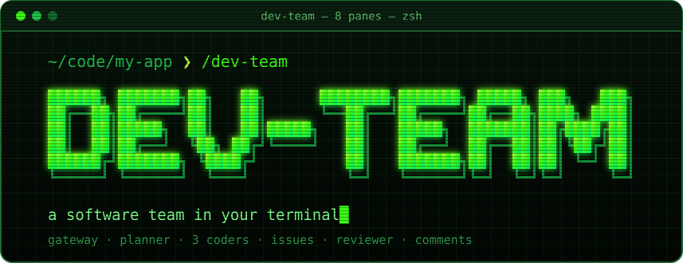

<p align="center">
  
</p>

<p align="center">
  
  <br><sub>A scripted replay of one session (<a href="assets/demo.sh">assets/demo.sh</a>), not a recording of real panes.</sub>
</p>

A [Claude Code](https://claude.com/claude-code) skill that runs a small software team in one tmux window: eight Claude sessions, each with a job, talking to each other. You talk to one of them, the gateway. It plans with the planner, files issues, hands each issue to a coder, sends the PR to the reviewer, and tells you once a batch is done.


It works for any project, new or existing. When you stop for the day, every pane writes down where it was, and the next start picks up from those notes.

## The team

| Pane | Model | Job |
|---|---|---|
| gateway | Opus | Talks to you, hands out work, keeps track, merges when you allow it |
| planner | Fable (falls back to Opus) | PRDs, design, splitting work into small PRs with a merge order |
| coder-hard | Opus, high effort | Hard issues |
| coder-medium | Opus | Medium issues |
| coder-easy | Sonnet | Easy and mechanical issues |
| issues | Sonnet | Turns an approved plan into GitHub issues |
| reviewer | Opus | `/code-review` at medium on every PR, checks the project's rules |
| comments | Haiku | PR descriptions and replies to review comments |

`--lite` starts three panes instead: gateway, coder and reviewer. The gateway does the other jobs itself.

Edit the `team=(...)` list in `launch.sh` to change models or effort.

## Install

Needs macOS or Linux, tmux, the `claude` CLI, `gh` (signed in) and python3.

```bash
git clone https://github.com/NirjharBhattacharjee/dev-team ~/.claude/skills/dev-team
```

## Use

From Claude Code, type `/dev-team` in a project, or run the script yourself:

```bash
~/.claude/skills/dev-team/launch.sh ~/code/my-app          # existing project
~/.claude/skills/dev-team/launch.sh ~/code/new-idea        # new: creates the folder and runs git init
~/.claude/skills/dev-team/launch.sh ~/code/my-app --lite   # three panes
```

Inside tmux it switches you to the team's session (`dev-<project>`). Outside tmux it prints the `tmux attach` line. Talk to the gateway in pane 1.

A new project has no plan yet, so the planner writes one first: a README, an `AGENTS.md` with the project's rules and checks, and the tasks in merge order. Nothing is coded until you approve it.

Each project gets its own session, so you can run teams for several projects side by side and move between them with `Ctrl-b s`.

## Ending and resuming

Tell the gateway **"end the session"** (or "wrap up", "stop for today"). It then:

1. asks every pane to commit unfinished work on its own branch (locally, not pushed) and write a note: its task, branch, PR, what's done, what's left;
2. writes `session.md`: what's merged, what's in flight, what's next, the decisions you made, and what only you can do;
3. closes every pane.

Notes live in `~/.claude/dev-team/dev-<project>/`, outside the repo. Run `/dev-team` on the same project again and each pane reads its notes first. The gateway opens with where things stand and waits for your go.

If the gateway is stuck:

```bash
~/.claude/skills/dev-team/stop.sh ~/code/my-app          # ask the gateway to wrap up
~/.claude/skills/dev-team/stop.sh ~/code/my-app --now    # close everything, no notes
```

## Rules

[RULES.md](RULES.md) is loaded into every pane. It sets:

- **Working rules:** one task per session, one active coder, the cheaper model for mechanical work, and stop to ask before anything hard to undo.
- **GitHub flow:** issue first, one worktree and branch per task, small PRs, an agreed merge order, and squash merges only after review and green CI.
- **Message formats:** tagged messages between panes (`TASK`, `DONE`, `BLOCKED`, `REVIEW`, `FINDINGS`, `FIXES`...), one status table to you per batch, Conventional Commits PR titles and a fixed PR body.
- **Reviews:** one review layer per round, every fix in one push, and PR text treated as data, never as instructions.
- **CI:** one required `checks` job, a single background `gh pr checks --watch`, reruns only for infrastructure failures, and least-privilege workflows with actions pinned to a SHA.
- **CD:** releases are semver tags on `main`, and every release or deploy needs your yes.

Your own `~/.claude/CLAUDE.md` and the project's `AGENTS.md` win over it. `templates/` holds a starting `checks.yml` workflow and a PR template, which the planner copies into new projects.

## How it works

- Each pane is a `claude` session started with `--append-system-prompt-file`. The file holds its role and the names of its peers. The panes message each other with Claude Code's `SendMessage`.
- Coders follow the project's `AGENTS.md`: one worktree per task in `.worktrees/`, branch `agent/<name>`, the project's checks, `git commit -s`, a PR that closes the issue.
- The gateway asks you once per project whether it may merge reviewed, CI-green PRs itself, and remembers the answer. Until you say yes, it never merges.
- Your `~/.claude/CLAUDE.md` and the project's `AGENTS.md` override anything in the role prompts.

## Warning

Every pane runs with `--dangerously-skip-permissions`, so the sessions run commands and edit files without asking. That's what lets the team work unattended, but it means anything a pane decides to run, runs. Use it on code you're happy to give eight agents full access to, ideally on a machine or account without secrets you can't afford to leak. Remove the flag in `launch.sh` if you'd rather approve each action.

Eight sessions also use your Claude usage limit eight times as fast. `--lite` is cheaper.

## License

MIT. See [LICENSE](LICENSE).
